# Givi | Web developer

I build responsive websites and dashboards with JavaScript, React, and TypeScript. I also write Python scripts for tasks like cleaning CSV files and calculating inventory totals.

I document how to run my projects and write tests for behavior like input validation and data recovery. I'm interested in small projects with international clients.

**[View my portfolio website](https://givi588.github.io/givi-portfolio/)** · [Website bug fixes on Fiverr](https://www.fiverr.com/givi588/fix-html-css-and-javascript-website-bugs) · [Discuss a project](https://github.com/givi588/givi588/issues/new?template=project-inquiry.yml) · [Email](mailto:pruidzegivi@gmail.com) · [Browse source code](https://github.com/givi588?tab=repositories)

## Open Source Contributions

My first open-source contribution was to **Disciplr Backend**. I expanded the OpenAPI spec to document API key management and the OAuth client credentials exchange, and added tests for the new spec entries.

[PR #1880 (merged)](https://github.com/Disciplr-Org/Disciplr-backend/pull/1880) · [Issue #1848 (closed)](https://github.com/Disciplr-Org/Disciplr-backend/issues/1848) · 100 points earned in Stellar Wave 11

## Featured projects

### Mira Flowers storefront

I built this storefront for a flower shop. Customers can browse the catalog, add flowers to a cart, and contact the shop to request an order.

[Live website](https://givi588.github.io/mira-flowers/) · [Case study](https://givi588.github.io/givi-portfolio/#case-study) · [Code](https://github.com/givi588/mira-flowers)

### Invoice & Quote Studio v1.1 (TypeScript)

A React and TypeScript app for quotes and invoices. Totals update as you edit, and drafts stay in your browser. You can back up drafts as JSON and print documents to PDF.

[Live demo](https://givi588.github.io/invoice-quote-studio/) · [Code](https://github.com/givi588/invoice-quote-studio) · [TypeScript lesson](https://github.com/givi588/invoice-quote-studio/blob/main/docs/TYPESCRIPT_LESSON.md)

### Category Dashboard 2.1

Search and sort inventory categories, see their totals, and recover deleted entries. I test the dashboard in Chromium, Firefox, and WebKit.

[Code](https://github.com/givi588/category-dashboard) · [Tests](https://github.com/givi588/category-dashboard/actions/workflows/javascript-tests.yml)

## Services

| Service | Example deliverables |
| --- | --- |
| **Websites & landing pages** | Responsive HTML/CSS/JavaScript websites, business information pages, catalogs, mobile layout improvements |
| **React & JavaScript applications** | Interactive dashboards, task managers, forms, search/filter interfaces, and lightweight inventory or sales tracking |
| **Python & CSV automation** | Data cleanup, calculations, inventory summaries, CSV exports, repeatable reports |
| **Small fixes & improvements** | Frontend bug fixes, UI refinements, input validation, documentation, and automated tests |

I confirm what's feasible before agreeing to a price or timeline. The examples here cover small websites and tools for everyday work.

## More projects

| Project | What it does | Demo & source |
| --- | --- | --- |
| **Sales & Inventory Manager** | Track products, stock and sales, export CSV reports, and maintain JSON backups in the browser. | [Live demo](https://givi588.github.io/sales-inventory-manager-clean/) · [Code](https://github.com/givi588/sales-inventory-manager-clean) |
| **Python Inventory Manager** | Calculate inventory value, flag low stock, and generate CSV reports from sample data. | [Code & instructions](https://github.com/givi588/python-inventory-manager) |
| **Python Sales Calculator v1.0.0** | Calculate sales revenue and create basic CSV reports, with automated tests. | [Release](https://github.com/givi588/python-sales-calculator/releases/tag/v1.0.0) · [Code](https://github.com/givi588/python-sales-calculator) |
| **React Training Dashboard** | Organize tasks by priority, search and filter progress, and save task updates locally in a responsive React interface. | [Live demo](https://givi588.github.io/react-training-dashboard/) · [Code](https://github.com/givi588/react-training-dashboard) · [Checks](https://github.com/givi588/react-training-dashboard/actions) |

### Category Dashboard 2.1 screenshot

## Tools and engineering practices

**HTML · CSS · JavaScript · TypeScript · React · Vite · Python · Git · GitHub Actions · GitHub Pages**

- Responsive layouts, practical UI controls, and accessible labeling.
- Input validation, data export/import, and documented browser-storage limitations.
- Automated tests, pull requests, code review, and versioned releases.
- Clear README instructions and transparent known limitations.

## Working together

1. **Describe the goal:** What should the website or script do? What is the expected output?
2. **Agree on scope:** We confirm requirements, deliverables, timeframe, budget and exclusions before work starts.
3. **Build and verify:** Changes are reviewed and tested against the agreed requirements.
4. **Handover:** I share the deliverable, setup instructions, and known limitations for acceptance.

### Have a project in mind?

For HTML, CSS, or JavaScript website fixes, **[view my Fiverr service](https://www.fiverr.com/givi588/fix-html-css-and-javascript-website-bugs)** to check the available packages and discuss the scope before ordering.

**[Open a project inquiry on GitHub](https://github.com/givi588/givi588/issues/new?template=project-inquiry.yml)** and share your goal, rough scope, target date, and budget range.

**Important:** GitHub Issues are **public**. Please do **not** post passwords, API keys, personal contact details, private customer data, or confidential project files. We can agree on a suitable private channel before exchanging sensitive information. An inquiry is not an automatic project acceptance.

[See all repositories](https://github.com/givi588?tab=repositories)
